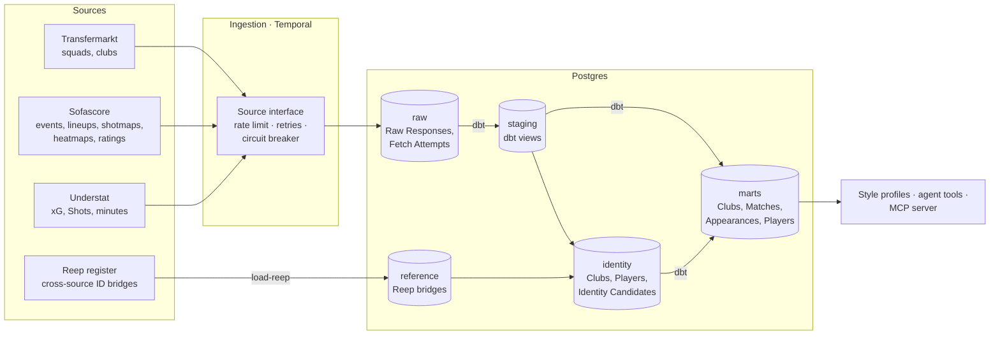
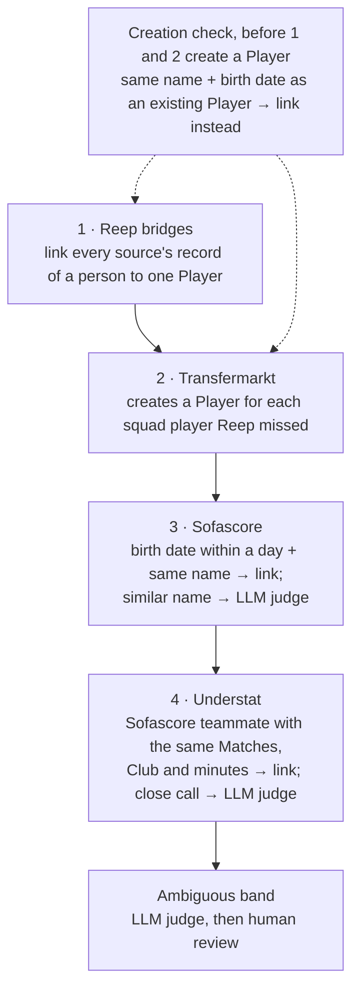

# football-data-ai-platform

> Durable football data ingestion with Temporal, and an AI scouting agent on top.

**Status:** early development — local proof of concept, milestone M3 of 7. A hosted MVP behind GitHub login follows. See the [roadmap](#roadmap).

## What it does

- **Ingests live football data** from Transfermarkt (via [`transfermarkt-api`](https://github.com/felipeall/transfermarkt-api)), Sofascore and Understat, using Temporal workflows built for unreliable sources: per-source rate limits, retries with backoff, circuit breakers, and a cache of every raw response.
- **Unifies players across sources** with an identity resolution workflow: deterministic rules, fuzzy matching, an LLM judge for ambiguous cases, and human review via Temporal signals.
- **Builds style profiles** from per-90 statistics and the on-pitch location of each player's actions, stored in pgvector for similarity search.
- **Answers scouting questions** through a provider-neutral AI agent (Claude first) exposed as an MCP server: *"left-back under 23, under €15M, similar to Grimaldo"*.
- **Measures itself** with an eval suite in CI and LLM tracing in Langfuse.

## The pipeline

Data flows one way: from the sources into an untouched raw store, then through dbt and identity resolution into marts the agent reads.



1. **Fetch.** Temporal workflows request each source through one source interface per source. The interface paces requests, retries with backoff and opens a circuit breaker when a source keeps failing.
2. **Store raw.** Every answer is stored untouched as a Raw Response in `raw.raw_responses` before anything parses it, and every request as a Fetch Attempt. A parser change re-runs on stored data, without fetching again.
3. **Stage.** dbt turns the latest successful Raw Response per URL into typed `staging` views: Matches, Appearances, Shots, squads and clubs per source.
4. **Resolve identities.** Clubs and Players get our own IDs in the `identity` schema, and each source's records link to them ([ADR 34](docs/adr/0034-canonical-ids-are-ours.md)).
5. **Build marts.** dbt joins staging and identity into cross-source `marts`: one Club, one Match and one Player, whichever source a record came from.
6. **Serve.** Style profiles and the scouting agent read only the marts (M4 onward).

## Data strategy

### Coverage

The proof of concept covers **one competition and one season: the Premier League, 25/26**, the last finished season ([ADR 35](docs/adr/0035-poc-covers-last-season.md)). A finished season does not change, so it can be ingested once and checked exactly. Matches already stored for 24/25 and 26/27 stay in `raw`. ADR 5's three seasons, which trend features need, come back once a second season is worth its cost: about 560 Transfermarkt requests, plus the Matches.

### Sources and what each is for

Each source answers a question the others cannot, and two independent sources of xG let us check one against the other ([ADR 3](docs/adr/0003-live-data-sources.md)).

| Source | What we take | Role | How we reach it | Pace |
| --- | --- | --- | --- | --- |
| **Sofascore** | Event, lineups with per-player statistics, shotmap, average positions, and each player's heatmap and rating breakdown (~70 requests a Match) | Match spine: who played, how long, where on the pitch | `curl_cffi` with Chrome impersonation; a Turnstile captcha, solved by camoufox about once an hour, buys the Captcha Token every request carries ([ADR 14](docs/adr/0014-scraping-access.md), [ADR 30](docs/adr/0030-sofascore-captcha-token.md)) | 1 request / 2 s; 15-min breaker cool-down |
| **Understat** | League data (teams, players, fixtures), and per Match the rosters and every Shot with its xG | Second, independent xG; Shot locations | Plain HTTP with the `X-Requested-With` header it requires | ~1 request / s |
| **Transfermarkt** | Competition clubs and each club's squad: names, birth dates, positions | Creates the Players Reep lacks; birth dates for age filters and identity checks | The [`transfermarkt-api`](https://github.com/felipeall/transfermarkt-api) SDK, in-process ([ADR 28](docs/adr/0028-transfermarkt-sdk.md)) | 1 request / s |
| **[Reep](https://reep.football)** | A pinned data release of person and team bridges across providers, SHA-256-verified | Links the same player or club across the three sources | Downloaded once per release into `data/reep/` | On upgrade only |

### Getting the data without getting blocked

The sources are scraped websites, not APIs with a contract, so ingestion is built to be polite and to resume ([ADR 4](docs/adr/0004-scraping-posture.md)):

- **One rate limit per source, shared by every workflow.** Running more Matches at once only queues more requests behind the same limit.
- **A circuit breaker per source.** After repeated failures, the source rests for its cool-down. Temporal schedules the next attempt for when the breaker reopens, instead of spending retries against it.
- **Backoff on failure:** 10 s, 20 s, 40 s, 80 s, then the attempt is given up. Errors that a retry cannot fix, such as a Match that does not exist or a Challenge no Captcha Token answers, fail at once.
- **Never fetch twice.** Within a source's Freshness Window (24 h by default), a stored Raw Response answers instead of the source. A finished Match never changes, so a Match stored completely is never requested again, whatever its age. A stopped or failed backfill resumes from where it was.
- **Stop at a Challenge.** When Sofascore challenges and no Captcha Token can be obtained, the backfill starts no further Matches. Every one it then made would be challenged too.
- **A residential connection.** Ingestion runs from a home connection, where the sources answer. Only derived outputs leave it ([ADR 22](docs/adr/0022-hosting.md)).
- **Measured breakage.** Fetch Attempts record every request, including timeouts, breaker rejections and blocked answers. `fdap success-rates` shows each source's daily success rate, so a source starting to block us shows as a falling rate.

### Refresh cadence

| What | How | When |
| --- | --- | --- |
| Sofascore history | Backfill: a Match-level pass (4 requests a Match), then a full pass adding per-player data, a season at a time | By hand, once per season covered |
| New Sofascore Matches | One post-match workflow per fixture sleeps until kickoff + 4 h (final whistle + 2 h, when statistics settle), then ingests the Match in full ([ADR 5](docs/adr/0005-coverage-and-refresh.md)) | Fixtures read daily at 06:00 UTC |
| Understat | The current season's league data, plus every played Match not stored yet | Daily at 07:00 UTC |
| Transfermarkt squads | Every club's squad in the competition season; a finished season's squads do not change | By hand, once per season |
| Reep | Pin a new release, load it, re-run Clubs and Identity Resolution; only records with no link yet get linked | By hand, on a new release |

While the stack runs locally, both Schedules are created paused and ingestion runs by hand. How the workflows, Schedules and durable timers work is in [`docs/temporal.md`](docs/temporal.md).

### One identity across sources

Each source has its own IDs for the same player, club and Match. The platform gives each one **our own** ID, given once and never changed, and links every Source Record to it ([ADR 6](docs/adr/0006-identity-resolution.md), [ADR 32](docs/adr/0032-reep-first-mapping-layer.md), [ADR 34](docs/adr/0034-canonical-ids-are-ours.md)):



- **Competitions and Stages** are entered by hand when we take one on. **Clubs** are created from Reep's team bridges and named after their Transfermarkt club (`brighton-and-hove-albion`). **Matches** are linked by Competition, season, home Club and away Club.
- Sofascore and Understat only link to Players; they never create one. A link our own data contradicts, such as a birth date that disagrees, waits for review instead of being trusted.
- Every link is an Identity Candidate with its method, confidence and evidence, so a wrong one can be traced and rejected.
- **The ambiguous band** is what the rules leave pending. `fdap judge` asks the LLM judge (Claude Haiku 5.5 through the `identity_judge` Model Role, traced in Langfuse) about each pending Candidate. A sure accept or reject (confidence 0.9 or more) decides it; the rest wait for a person. `fdap review` lists them, and `fdap review approve <id>` or `fdap review reject <id>` sends the decision as a Temporal signal to the `identity-review` workflow. Rejecting a wrong Reep link the same way reopens its record to the rules ([ADR 32](docs/adr/0032-reep-first-mapping-layer.md)). The next `fdap transform` carries the decisions into the marts.

### Transforms

dbt owns `staging` and `marts`, and Alembic owns `identity` ([ADR 11](docs/adr/0011-transform-layer.md), [ADR 31](docs/adr/0031-identity-schema-and-transform-runs.md)). A Transform Run builds them in order: staging, then Clubs, then the Club and Match marts, then Identity Resolution for Players, then the marts that read it. Marts lag ingestion by up to a day, which scouting questions can afford. One `TransformWorkflow` runs them, one run at a time, started by `fdap transform`.

## Architecture (planned)

```
 Developer machine                                  Hosted (MVP)
┌──────────────────────────────────────┐     ┌──────────────────────────────────────┐
│ Sources ─▶ Temporal workflows        │     │ Neon Postgres (marts, pgvector)      │
│              │                       │     │   ▲ read-only                        │
│              ▼                       │     │   │                                  │
│ Postgres (raw JSONB) ─▶ dbt ─────────┼────▶│ FastAPI + Claude agent (Fly.io)      │
│                                      │     │   ▲                                  │
│ MCP server (local PoC)               │     │ Next.js chat, GitHub login (Vercel)  │
└──────────────────────────────────────┘     └──────────────────────────────────────┘
```

Ingestion stays on a residential connection, where the sources answer; the hosted app serves derived outputs only ([ADR 22](docs/adr/0022-hosting.md)).

## Tech stack

ADR numbers refer to [`docs/adr/`](docs/adr/).

| Layer | Technology | Runs on | Phase | ADR |
|---|---|---|---|---|
| Language & tooling | Python 3.13, `uv`, `ruff`, `pyright`, `pytest`, `import-linter`, `gitleaks` | local + CI | PoC | 15, 24 |
| Orchestration | Temporal: Schedules, post-match workflows, durable timers, signals | local | PoC | 5, 6 |
| Source: Transfermarkt | [`transfermarkt-api`](https://github.com/felipeall/transfermarkt-api) SDK, in-process | local | PoC | 2, 3, 28 |
| Source: Sofascore | `curl_cffi` browser impersonation, Playwright fallback | local (residential IP) | PoC | 3, 14 |
| Source: Understat | HTTP | local | PoC | 3 |
| Ingestion resilience | Per-source rate limits, retries with backoff, circuit breaker, raw response cache | local | PoC | 4 |
| Database | Postgres 17 + pgvector (raw JSONB → staging → marts) | local (Docker) | PoC | 11 |
| Transforms | dbt (Postgres adapter), run as a Temporal activity | local | PoC | 11 |
| Identity resolution | Rules → fuzzy matching → LLM judge (Claude Haiku 5.5) → human review via Temporal signal | local | PoC | 6 |
| Style profiles | Per-90 stats + 12×8 pitch grid, cosine similarity in pgvector | local | PoC | 12 |
| Agent harness | `AgentRunner` / `LLMClient` ports; `ClaudeRunner` (Anthropic SDK Tool Runner); `ScriptedRunner` test double | local + hosted | PoC | 24 |
| LLM | Anthropic API (backend configurable); Claude Sonnet 5.5 for chat, reports and eval judge; Claude Haiku 5.5 for identity resolution | API | PoC | 24, 25 |
| Agent tools | Typed tools + read-only SQL fallback on marts | local + hosted | PoC | 13 |
| MCP | MCP server over the same tools (Claude Desktop, Claude Code) | local | PoC | 8 |
| Observability | Langfuse — self-hosted locally, Langfuse Cloud for hosted traffic | local / cloud | PoC / MVP | 18, 22 |
| Evals | Deterministic checks + LLM judge in GitHub Actions, README badge | CI | MVP | 9 |
| Long-running jobs | Temporal workflow, one Scouting Report per activity | local | MVP | 24 |
| API | FastAPI | Fly.io | MVP | 22 |
| UI | Next.js chat with inline charts | Vercel | MVP | 8, 22 |
| Auth & limits | GitHub login (Auth.js), 10 queries per user per day, Anthropic console spend limit | hosted | MVP | 22 |
| Hosted database | Neon Postgres + pgvector (read-only for the app; local workers write) | cloud | MVP | 22 |
| CI/CD | GitHub Actions: lint, types, tests, import contracts, evals | GitHub | PoC → MVP | 15 |

## Roadmap

Seven milestones in order, no deadlines ([ADR 27](docs/adr/0027-milestones-without-timing.md)). Work items live in [GitHub milestones](https://github.com/felipeall/football-data-ai-platform/milestones).

| Milestone | Phase | Delivery | Status |
|---|---|---|---|
| M1 | PoC | Compose stack, source interface, Transfermarkt, raw response cache, CI | ✅ |
| M2 | PoC | Sofascore, post-match workflows, three-season Match-level backfill (full pass in M7) | ✅ |
| M3 | PoC | Understat, dbt, identity resolution | 🚧 |
| M4 | PoC | Style profiles, agent tools, `ClaudeRunner` + `ScriptedRunner`, MCP server — Claude Desktop answers locally | ⏳ |
| M5 | MVP | Evals in CI, durable scouting report job | ⏳ |
| M6 | MVP | Next.js UI, FastAPI, GitHub login, quota | ⏳ |
| M7 | MVP | Deploy (Neon, Fly.io, Vercel); local workers sync to Neon | ⏳ |

**Backlog:** `LiteLLMRunner` (OpenAI, Gemini, Bedrock, Ollama, vLLM) and provider comparison evals, LiteLLM gateway, transfer rumor tracker, Opta feeds, WhoScored events, learned style embeddings, more leagues.

## Getting started

Requires Docker with Compose, and [`uv`](https://docs.astral.sh/uv/).

```sh
cp .env.example .env        # then replace the placeholder values
docker compose up --wait    # Postgres, Temporal (UI at localhost:8233), migrations, worker
uv run fdap ingest-match 16363874
```

[`docs/running-locally.md`](docs/running-locally.md) covers every command, from backfills and Schedules to dbt, Reep and identity resolution, and the development tools.

## Documentation

- [`docs/temporal.md`](docs/temporal.md): how Temporal runs ingestion, and each workflow
- [`docs/running-locally.md`](docs/running-locally.md): the stack, every command, development tools
- [`GLOSSARY.md`](GLOSSARY.md): domain glossary
- [`docs/adr/`](docs/adr/): architecture decision records
- [`AGENTS.md`](AGENTS.md): rules for coding agents (commits, branches, pull requests, critical review)
- [`docs/agents/worktrees.md`](docs/agents/worktrees.md): parallel agents in Orca worktrees, each with its own database and task queue on the shared stack
- [`docs/agent-skills.md`](docs/agent-skills.md): official agent skills enabled for coding agents

## Data disclaimer

This project collects data from third-party websites for personal, non-commercial research. No scraped data is stored in or distributed through this repository. The same goes for the Reep register's releases: they are CC0 but derived from providers' data, so they stay under `data/` and in the database. If you run it, you are responsible for complying with each source's terms of service.

## Prior work

This project supersedes [`football-data-platform`](https://github.com/felipeall/football-data-platform) (v1, archived).

## License

[MIT](LICENSE)
