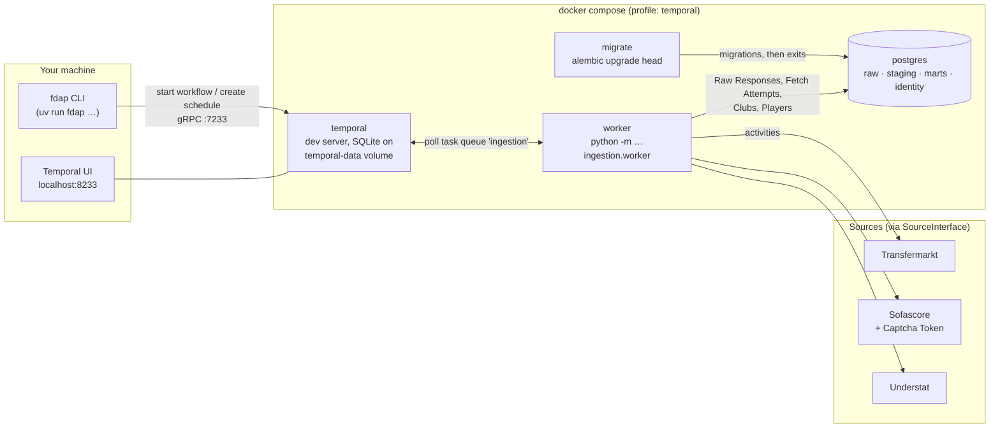
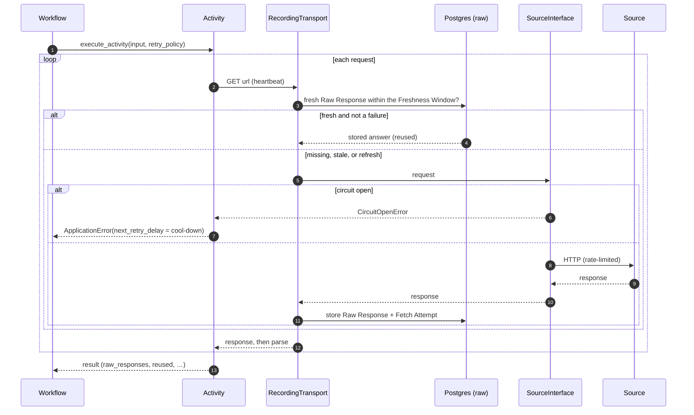
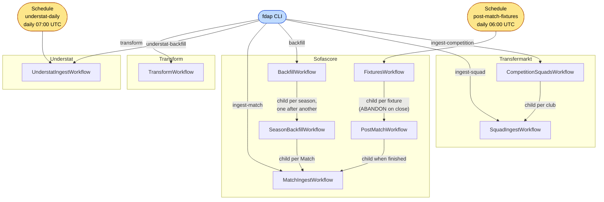
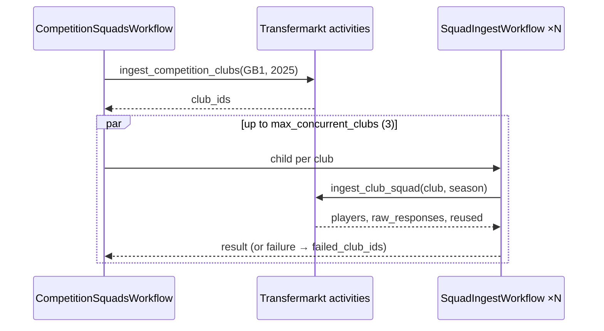
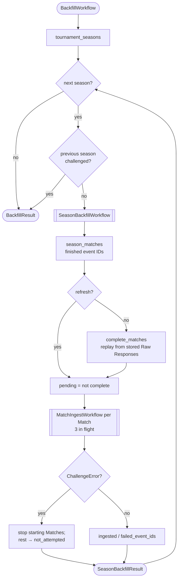
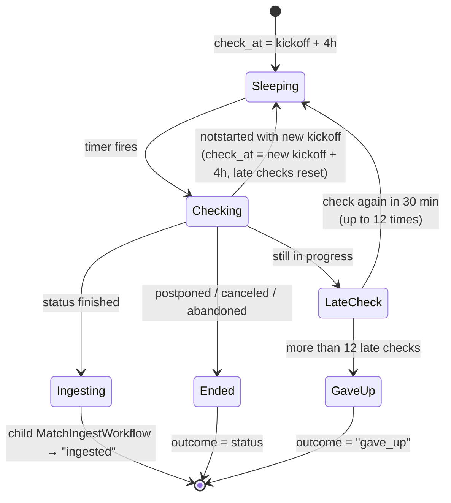
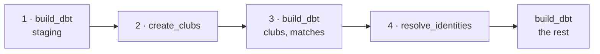

# Temporal in this project

Temporal runs ingestion and other long-running jobs. It fetches data from the sources (Transfermarkt, Sofascore, Understat) and stores it as Raw Responses in Postgres, then creates and links Clubs and Players. Chat does not go through Temporal: the agent calls its runner directly (see `AGENTS.md`).

This page covers how Temporal is set up here, the rules the code follows, and each workflow. Terms in capitals (Raw Response, Match, Freshness Window…) are defined in [`GLOSSARY.md`](../GLOSSARY.md).

Code:

| File | Contents |
| --- | --- |
| `src/football_data_ai_platform/ingestion/workflows.py` | Ingestion workflows and their retry policies |
| `src/football_data_ai_platform/ingestion/activities.py` | Ingestion activities: all HTTP and database I/O |
| `src/football_data_ai_platform/ingestion/models.py` | Workflow and activity inputs and results (frozen dataclasses) |
| `src/football_data_ai_platform/ingestion/schedules.py` | Temporal Schedules |
| `src/football_data_ai_platform/ingestion/worker.py` | The worker process |
| `src/football_data_ai_platform/ingestion/cli.py` | `fdap`, the CLI that starts workflows and creates Schedules |
| `src/football_data_ai_platform/identity/activities.py` | Identity activities (Clubs, Identity Resolution) |
| `src/football_data_ai_platform/transform/workflows.py` | `TransformWorkflow`, the Transform Run, and its dbt selections |
| `src/football_data_ai_platform/transform/dbt.py` | The dbt activity: `dbt build` as a subprocess |

## Temporal in brief

Temporal runs code durably. A **workflow** is a function whose progress Temporal records as an event history. If the worker dies, another worker replays that history and the workflow continues from where it stopped. Replay only works if workflow code is **deterministic**, so workflows do no I/O. They call **activities**, which do the I/O and which Temporal retries according to a **retry policy**. **Workers** poll a **task queue** for workflow and activity tasks. A **Schedule** starts a workflow on a calendar. **Durable timers** (`workflow.sleep`) can wait hours or days and still fire after a restart.

What that gives this project:

- **Unreliable sources are retried with backoff.** A failed request does not lose the work already done, because the Raw Responses already stored are reused.
- **Long backfills survive restarts.** A three-season Sofascore backfill takes about a day and a half.
- **Post-match waits are durable.** A workflow per fixture sleeps until kickoff + 4 hours.
- **Every run is visible** in the Temporal UI, with its inputs, results, failures and retries.

## Runtime



- **Server.** `temporalio/temporal` runs `server start-dev` in Compose, with gRPC on `localhost:7233` and the UI on <http://localhost:8233>. Its state (Schedules, sleeping workflows, history) lives in SQLite on the `temporal-data` volume, so it survives `docker compose down`. `docker compose down -v` deletes it.
- **Namespace and task queue** come from settings (`config.py`): `TEMPORAL_NAMESPACE` (default `default`) and `TEMPORAL_TASK_QUEUE` (default `ingestion`).
- **Worker.** `worker` in `compose.yaml` runs `main`'s code against the live database. It starts after `migrate` has applied migrations and Temporal is healthy. One process registers every workflow and activity (`worker.py`). It builds a single `SourceInterface` per source, so all concurrent activities share one rate limit, circuit breaker and, for Sofascore, one Token Provider and Captcha Token.
- **Worktrees** get their own task queue (`wt-<slug>`) and database from `scripts/worktree.sh`. Branch code therefore never runs on the live worker. A workflow started from a worktree needs a worker started from that worktree. See [`docs/agents/worktrees.md`](agents/worktrees.md).

## Rules the workflow code follows

1. **Workflows are deterministic.** HTTP, database and LLM calls happen only in activities. Workflows read time through `workflow.now()` and wait with `workflow.sleep()`. Activity and model imports go through `workflow.unsafe.imports_passed_through()`.
2. **Every source request goes through the common `SourceInterface`.** It owns the rate limit, retries and circuit breaker. Activities wrap it in a recording transport (`_recording` in `activities.py`).
3. **Store first, parse second.** The recording transport stores each answer as a Raw Response, and records each request as a Fetch Attempt, before parsing. Within the source's Freshness Window, a stored Raw Response answers the request instead of the source. A retried attempt therefore fetches only what is still missing. `refresh=True` skips the window.
4. **Fan-out goes to child workflows,** one per club, Match or season. A child that fails is listed in the parent's result and does not stop its siblings. A semaphore caps the children in flight (`max_concurrent_*`, default 3), since they share the source's rate limit anyway.
5. **Workflow IDs are deterministic.** A re-run reuses the same ID, so Temporal refuses a duplicate while the first run is open, and a fixture read on several days starts only one post-match workflow.

### One activity attempt



### Retry policies and timeouts

Each source has its own retry policy in `workflows.py`, all with the same polite backoff: 10 s, 20 s, 40 s, then 80 s between five attempts, capped at 5 minutes. Each source's `NON_RETRYABLE_ERRORS`, such as a Sofascore `ChallengeError` or a Match not found, fail at once. When the circuit breaker is open, the attempt fails with `next_retry_delay` set to the breaker's cool-down, so Temporal waits for the breaker instead of using up attempts.

| Activity | Start-to-close | Heartbeat | Retry |
| --- | --- | --- | --- |
| `ingest_club_squad`, `ingest_competition_clubs` | 5 min | — | Transfermarkt policy |
| `ingest_match` (~70 requests) | 30 min | 1 min | Sofascore policy |
| `tournament_seasons`, `season_matches`, `upcoming_fixtures` | 5 min | — | Sofascore policy |
| `complete_matches` (replays stored Matches) | 30 min | 1 min | Sofascore policy |
| `match_status` | 2 min | — | Sofascore policy |
| `ingest_season` (Understat, ~380 requests) | 1 h | 1 min | Understat policy |
| `create_clubs` | 5 min | — | 3 attempts |
| `resolve_identities` | 10 min | — | 3 attempts |
| `build_dbt` | 30 min | — | 3 attempts; a failed model or test (exit 1) none |

Long activities heartbeat on every request. A dead worker is then noticed within a minute instead of at the end of the start-to-close timeout.

## Workflows

Ten workflows, all registered on the one worker:



### Workflow IDs and how to start each

| Workflow | Started by | Workflow ID |
| --- | --- | --- |
| `SquadIngestWorkflow` | `fdap ingest-squad <club> --season <year>` | `squad-<club>-<season>` |
| `CompetitionSquadsWorkflow` | `fdap ingest-competition --season <year>` | `competition-squads-<competition>-<season>`; children `…-squad-<club>` |
| `MatchIngestWorkflow` | `fdap ingest-match <event id>` | `match-<event id>`; as a child `…-match-<event id>` or `…-ingest` |
| `BackfillWorkflow` | `fdap backfill [--season 24/25] [--match-level]` | `backfill-17` (`backfill-17-24-25` for `--season 24/25`); children `…-season-<season id>` |
| `SeasonBackfillWorkflow` | `BackfillWorkflow` only | `<parent>-season-<season id>` |
| `FixturesWorkflow` | Schedule `post-match-fixtures` | `post-match-fixtures` (plus the Schedule's timestamp suffix) |
| `PostMatchWorkflow` | `FixturesWorkflow` only | `post-match-<event id>` |
| `UnderstatIngestWorkflow` | `fdap understat-backfill [--season 2025]`; Schedule `understat-daily` | `understat-EPL[-<year>]`; `understat-daily` |
| `TransformWorkflow` | `fdap transform` | `transform`; a start while it runs joins that run |

The CLI uses `execute_workflow` (`transform`: `start_workflow`, then the result): it waits for the result and prints a summary. Run the CLI on the host with `uv run fdap …`. The workflow runs on whichever worker polls the configured task queue.

### Transfermarkt squads

`CompetitionSquadsWorkflow` stores every club's squad in one competition season. It lists the clubs (`ingest_competition_clubs`), then starts one `SquadIngestWorkflow` per club, three at a time. A squad that fails goes into `failed_club_ids`, and the other clubs still run. `SquadIngestWorkflow` is a single activity call, `ingest_club_squad`, that stores the club's squad pages as Raw Responses.



### Sofascore backfill

`BackfillWorkflow` stores a tournament's latest three seasons (ADR 5), or one chosen season. It runs one `SeasonBackfillWorkflow` child per season, **one after another**.

`SeasonBackfillWorkflow` lists the season's finished Matches. Unless `refresh` is set, it then asks `complete_matches` which ones already replay fully from stored Raw Responses, and skips those without a request. This makes a re-run resume where the last one stopped. Each remaining Match runs as a `MatchIngestWorkflow` child, three at a time.

A Sofascore **Challenge** that no Captcha Token can answer fails as a non-retryable `ChallengeError`. The season then starts no further Matches and lists them in `not_attempted_event_ids`, and the backfill starts no further seasons.



`--match-level` sets `per_player=False`: event, lineups, shotmap and average positions, 4 requests a Match. The full pass adds each appearing player's heatmap and rating breakdown, about 70 requests a Match. It reuses Match-level responses still inside the Freshness Window.

### Post-match refresh

ADR 5 refreshes a Match once it has been played. The Schedule `post-match-fixtures` runs `FixturesWorkflow` daily at 06:00 UTC for the Premier League. That workflow reads upcoming fixtures and, for each one kicking off within 8 days, starts a `PostMatchWorkflow` with ID `post-match-<event id>` and `ParentClosePolicy.ABANDON`, so the child outlives its parent. If a fixture already has a running post-match workflow, the start raises `WorkflowAlreadyStartedError` and the fixture is counted as `already_scheduled`.

Each `PostMatchWorkflow` waits on a durable timer, then checks the Match:



A postponed Match ends its workflow. A later `FixturesWorkflow` run sees the new date and starts a new one. Pausing the Schedule does not stop post-match workflows already sleeping.

### Understat

`UnderstatIngestWorkflow` stores a league's latest seasons, ending with the current one (`count`, default 3), or one chosen `year`. Seasons run one after another, one `ingest_season` activity each. Understat names a season by its start year, and the current one is chosen from `workflow.now()` with an August cut-over (`current_understat_year`).

`ingest_season` always fetches the league data, because it changes as Matches are played. It then fetches only the played Matches with no stored answer: a played Match never changes, so whether it is stored decides, not the Freshness Window. A Match that fails is listed in `failed_match_ids`.

The Schedule `understat-daily` runs it at 07:00 UTC with `count=1`, which stores the current season and the Matches played since the last run.

### Transform

`TransformWorkflow` is the Transform Run (ADR 31, amended by ADR 34): four steps, each an activity, run in order.



- `build_dbt` runs `dbt build` as a subprocess of the worker, with the step's selection and `--indirect-selection cautious`, so each test runs in the step that builds the last of its parents. dbt writes its target and logs to a temporary directory. Exit 1, a failed model or test, fails non-retryably; a cancelled attempt kills its dbt.
- `create_clubs` creates and links the Clubs of the stored Matches' teams from the pinned Reep release, named after the Transfermarkt club. Without `REEP__RELEASE` it fails non-retryably.
- `resolve_identities` creates Players and links the staged Source Records to them.

Each is one transaction or one dbt build, so a retried step starts clean. A team or player that links to nothing is in the result, never a failure. The result carries each step's time, measured with `workflow.now()`.

The workflow ID is fixed, `transform`. `fdap transform` tries to start it. If a run is already open, Temporal refuses the start with `WorkflowAlreadyStartedError`, and the command joins the open run and waits for its result instead, so only one Transform Run runs at a time. The command says which happened: `Started Transform Run <run id>`, or `Joined Transform Run <run id>, started <time>`. A joined run can be live's, started from a worktree. When the joined run's task queue isn't the caller's, the command names that queue and warns that the run writes to that worker's database. No Schedule starts it while the stack is local.

## Schedules

| Schedule ID | Workflow | When | Overlap | Created by |
| --- | --- | --- | --- | --- |
| `post-match-fixtures` | `FixturesWorkflow(tournament_id=17)` | daily 06:00 UTC | `SKIP` | `fdap schedule-post-match` |
| `understat-daily` | `UnderstatIngestWorkflow(league="EPL", count=1)` | daily 07:00 UTC | `SKIP` | `fdap schedule-understat` |

The `fdap schedule-*` commands create a Schedule, or update it to the current definition, so they are safe to re-run. Schedules are **created paused**, because ingestion runs by hand while the stack is local. To operate them:

```sh
temporal schedule list
temporal schedule trigger --schedule-id post-match-fixtures            # one run, even while paused
temporal schedule toggle  --schedule-id post-match-fixtures --unpause --reason "<why>"
```

After `docker compose down -v`, recreate them with the `fdap schedule-*` commands.

## Testing

Workflow tests use `temporalio.testing.WorkflowEnvironment` (fixtures in `tests/conftest.py`). The `temporal` fixture starts a local dev server; `time_skipping` starts the time-skipping server, which lets `PostMatchWorkflow`'s hours-long timers run in milliseconds. See `tests/test_squad_workflow.py`, `test_competition_squads.py`, `test_backfill.py`, `test_post_match.py` and `test_understat.py`.

## Operating and debugging

- **Find a run:** open <http://localhost:8233> and search for the workflow ID from the table above, such as `backfill-17`, `post-match-16363874` or `transform`.
- **Read the result:** each workflow returns a dataclass from `models.py` with its counts: `raw_responses` (fetched from the source), `reused` (answered from storage), and failed or not-attempted IDs.
- **Resume a backfill:** run the same command again. Complete Matches are skipped, and failed or not-attempted ones are fetched.
- **Worker logs:** `docker compose logs -f worker`.
- **After a merge:** from the main checkout, `docker compose up --wait --build` rebuilds the worker with the merged code and applies new migrations. Workflows already running continue on the new code, so keep changes to running workflows replay-compatible.
- **A start that waits forever:** no worker polls that task queue. Usually this is a worktree queue with no worktree worker running.

## Related ADRs

- [ADR 5](adr/0005-coverage-and-refresh.md): coverage and refresh cadence (three seasons, final whistle + 2 h)
- [ADR 6](adr/0006-identity-resolution.md): identity resolution
- [ADR 14](adr/0014-scraping-access.md), [ADR 30](adr/0030-sofascore-captcha-token.md): scraping access and the Sofascore Captcha Token
- [ADR 24](adr/0024-provider-neutral-agent.md): chat runs the runner directly, and Temporal handles long-running jobs
- [ADR 31](adr/0031-identity-schema-and-transform-runs.md), [ADR 34](adr/0034-canonical-ids-are-ours.md): Transform Runs and their steps
